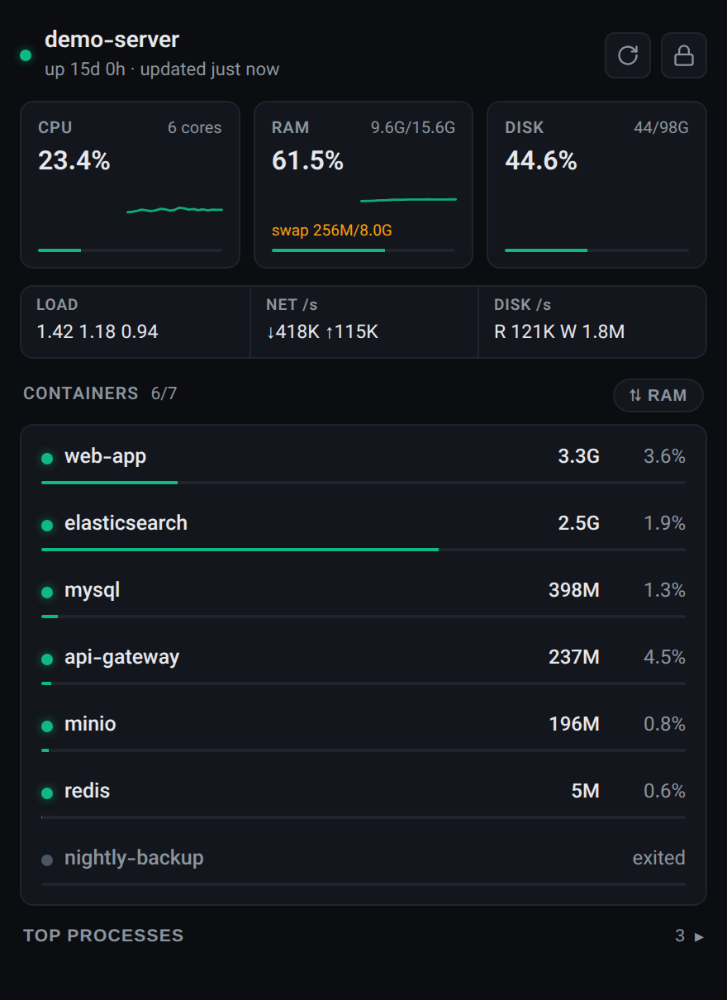

# Server-Pulse

Ultra-lightweight, zero-bloat Linux server & Docker container monitor with a minimal OLED Dark web dashboard and Chrome Manifest V3 extension.

<p align="center">
  
</p>

📖 **Full install guide / راهنمای کامل نصب:** [English](./docs/INSTALL.md) · [فارسی](./docs/INSTALL.fa.md)

**Languages:** [English](#english) · [فارسی](#فارسی)

---

<a id="english"></a>

## English

* **Micro-Agent (Go stdlib only):** `~8 MB` `FROM scratch` Docker image with the web dashboard embedded (`go:embed`), `~3–5 MB` RAM, `0.00%` idle CPU, read-only Docker socket (`:ro`), `2.5s` single-flight cache.
* **Chrome MV3 Extension (Vanilla HTML/CSS/JS):** `~37 KB` total (`17 KB` zipped), zero frameworks (`no React/npm`), strict CSP, live toolbar Badge (`RAM%` or `CPU%`), per-container RAM/CPU rows, collapsible Top Processes.

---

## 30-Second Quickstart

### 1. Install the Agent on Your Server (1 command)

```bash
curl -fsSL https://raw.githubusercontent.com/Man30ur/server-pulse/main/deploy/install.sh | bash
```

The installer pulls the prebuilt `~8 MB` multi-arch image (`ghcr.io/man30ur/server-pulse`, falls back to a local build), generates a 64-char random Bearer token in `.env` (`chmod 600`), starts the read-only container, verifies `/health`, and prints two links:

```text
http://YOUR_SERVER_IP:9191/#YOUR_GENERATED_TOKEN     <- instant web dashboard (no install, works on phones)
pulse://YOUR_SERVER_IP:9191#YOUR_GENERATED_TOKEN     <- Chrome extension quick-connect
```

### 2. Open the Dashboard (1 click)

Click the `http://...#TOKEN` link. The token is saved in the browser's `localStorage` and immediately stripped from the address bar.

### 3. Optional: Chrome Extension for the Live Toolbar Badge

1. Download **`server-pulse-extension.zip`** from the [Latest Release](https://github.com/Man30ur/server-pulse/releases/latest) and unzip it.
2. Open `chrome://extensions`, enable **Developer mode**, click **Load unpacked**, and select the unzipped folder.
3. Click the **Server-Pulse** icon in Chrome, paste the `pulse://...` link into **Server URL** — URL and Bearer Token split automatically — and click **Save & Connect**.

Done! Both the extension and your credentials stay saved permanently in `chrome.storage.local`.

---

## Security by Design

* **Read-Only Access:** Docker socket is mounted `:ro` and the agent only issues HTTP `GET` requests. No exec, restart, or mutation endpoints exist.
* **Minimal Host Exposure:** Mounts only `/var/run/docker.sock:ro`, `/proc:/host/proc:ro`, and `/etc/hostname:/host/hostname:ro` (never mounts host `/`), with `read_only: true`, `cap_drop: [ALL]`, `no-new-privileges:true`, and `mem_limit: 32m`.
* **Timing-Safe Auth:** Every `/api/*` request requires `Authorization: Bearer <PULSE_TOKEN>` verified with `crypto/subtle.ConstantTimeCompare`.
* **Strict CSP everywhere:** Zero inline scripts, zero `eval`, zero `innerHTML` in both the extension and the embedded web dashboard (served with `script-src 'self'`); CORS restricted to `chrome-extension://`. The dashboard's static files are public, but all data stays behind the Bearer-protected `/api/metrics`.

---

## Configuration (`.env`)

See [`.env.example`](./.env.example):

| Variable | Default | Description |
| :--- | :--- | :--- |
| `PULSE_BIND` | `0.0.0.0` | Listen interface |
| `PULSE_PORT` | `9191` | HTTP port |
| `PULSE_TOKEN` | *(required)* | 64-char random Bearer secret (`openssl rand -hex 32`) |
| `PULSE_CACHE_TTL_MS` | `2500` | Snapshot cache TTL (prevents Docker socket hammering) |
| `PULSE_TOP_PROCESSES` | `6` | Number of non-container host processes returned |
| `PULSE_HOSTNAME` | host `/etc/hostname` | Optional display name in the popup |

---

## Development & Tests

```bash
# Run Go unit & E2E tests (mock Docker Unix socket + mock /proc + RSS check)
(cd agent && go test -v -race ./...)
(cd tests && go test -v ./...)

# Run Chrome MV3 extension & strict CSP tests
node --test tests/extension_test.mjs

# Build dist/server-pulse-extension.zip for GitHub Releases / Chrome Web Store
bash deploy/pack-extension.sh
```

## License

[MIT](./LICENSE)

---

<a id="فارسی"></a>

<div dir="rtl">

## فارسی

**Server-Pulse** یک ابزار فوق‌سبک برای دیدن وضعیت زنده سرور لینوکسی و کانتینرهای داکر است: مصرف CPU، رم و دیسک، تک‌تک کانتینرها و برنامه‌های پرمصرف، در یک صفحه تیره و مینیمال.

- **ایجنت روی سرور:** یک ایمیج حدود ۸ مگابایت، مصرف رم حدود ۳ تا ۵ مگابایت و CPU تقریباً صفر.
- **داشبورد وب:** بدون نصب هیچ برنامه‌ای، حتی روی گوشی.
- **افزونه Chrome (اختیاری):** نمایش درصد مصرف روی آیکون نوار مرورگر.

### نصب سریع

۱. روی سرور (با SSH) این یک خط را اجرا کنید:

</div>

```bash
curl -fsSL https://raw.githubusercontent.com/Man30ur/server-pulse/main/deploy/install.sh | bash
```

<div dir="rtl">

۲. در پایان دو لینک چاپ می‌شود. لینک `http://...#TOKEN` را در مرورگر باز کنید تا داشبورد زنده را ببینید.

۳. (اختیاری) برای افزونه Chrome، فایل `server-pulse-extension.zip` را از [Releases](https://github.com/Man30ur/server-pulse/releases/latest) دانلود کنید، در `chrome://extensions` با **Load unpacked** نصب کنید و لینک `pulse://...` را در تنظیمات افزونه پیست کنید.

### امنیت

- برنامه فقط می‌خواند و هیچ راهی برای تغییر یا اجرای دستور روی سرور ندارد.
- دسترسی به API فقط با توکن تصادفی ۶۴ کاراکتری ممکن است. توکن مثل رمز عبور است و نباید با کسی به اشتراک گذاشته شود.

📖 **راهنمای کامل و قدم‌به‌قدم همراه با سوال‌های رایج:** [docs/INSTALL.fa.md](./docs/INSTALL.fa.md)

</div>

