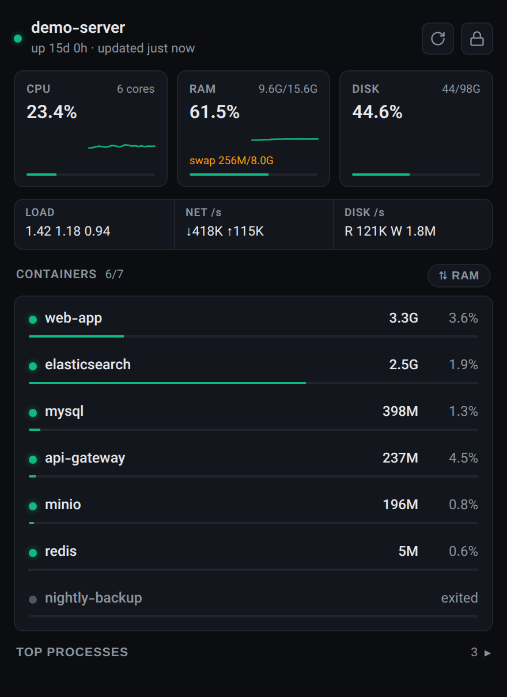

<div dir="rtl">

# آموزش نصب Server-Pulse (فارسی و ساده)

🌐 [English](./INSTALL.md) · [فارسی](./INSTALL.fa.md)

Server-Pulse یک ابزار سبک برای دیدن وضعیت سرور شماست: مصرف CPU، رم و دیسک، تک‌تک کانتینرهای داکر و برنامه‌های پرمصرف، همه زنده و در یک صفحه تمیز و تیره.



> تصویر بالا با داده‌های نمونه (دمو) ساخته شده است.

---

## قبل از شروع، این‌ها را لازم دارید

| مورد | توضیح |
| :--- | :--- |
| یک سرور لینوکسی | هر سرور اوبونتو، دبیان و مشابه آن |
| Docker و Docker Compose | روی همان سرور نصب باشد (با `docker compose version` چک کنید) |
| دسترسی SSH | همان روشی که همیشه به سرورتان وصل می‌شوید |
| باز بودن پورت `9191` | اگر روی سرور فایروال دارید، این پورت باید باز باشد |

نیازی نیست چیزی روی کامپیوتر یا گوشی خودتان نصب کنید. فقط یک مرورگر کافی است.

---

## مرحله ۱: نصب روی سرور (فقط یک بار)

۱. با SSH به سرورتان وصل شوید.

۲. این یک خط را کپی و اجرا کنید:

```bash
curl -fsSL https://raw.githubusercontent.com/Man30ur/server-pulse/main/deploy/install.sh | bash
```

۳. چند ثانیه صبر کنید. این کارها خودکار انجام می‌شود:

- برنامه در پوشه `/opt/server-pulse` قرار می‌گیرد (اگر دسترسی root ندارید، در پوشه خانگی‌تان).
- یک **توکن تصادفی** ساخته می‌شود. توکن مثل رمز عبور است.
- برنامه با Docker اجرا می‌شود.

۴. در پایان، چنین خروجی‌ای می‌بینید:

```text
 1) Instant web dashboard (no install, works on phones too):
   http://IP_SERVER:9191/#TOKEN

 2) Chrome extension (live toolbar badge) - paste this link in it:
   pulse://IP_SERVER:9191#TOKEN
```

این دو لینک را جایی امن نگه دارید.

---

## مرحله ۲: دیدن وضعیت سرور (ساده‌ترین راه)

لینک اول را که با `http://` شروع می‌شود، در مرورگر باز کنید (روی کامپیوتر یا گوشی). همین‌قدر!

- اطلاعات هر ۳ ثانیه خودکار تازه می‌شود.
- مرورگر توکن را به خاطر می‌سپارد و آن را از آدرس‌بار پاک می‌کند. دفعه بعد فقط آدرس `http://IP_SERVER:9191` را باز کنید.
- بخش **TOP PROCESSES** را برای دیدن برنامه‌های پرمصرف باز کنید.
- با دکمه چرخشی بالا، اطلاعات را همین الان تازه کنید.

### رنگ‌ها یعنی چه؟

| رنگ | معنی |
| :--- | :--- |
| سبز | مصرف عادی (زیر ۶۵٪) |
| زرد | مصرف بالا (۶۵٪ تا ۸۵٪) |
| قرمز | مصرف خیلی بالا (بالای ۸۵٪) |
| خاکستری | کانتینر خاموش است |

---

## مرحله ۳ (اختیاری): افزونه Chrome برای نمایش روی آیکون

اگر می‌خواهید درصد مصرف سرور همیشه روی آیکون نوار مرورگر دیده شود:

۱. به صفحه [Releases](https://github.com/Man30ur/server-pulse/releases/latest) بروید و فایل `server-pulse-extension.zip` را دانلود کنید. سپس از حالت زیپ دربیاورید.

۲. در Chrome آدرس `chrome://extensions` را باز کنید.

۳. کلید **Developer mode** (بالا سمت راست) را روشن کنید.

۴. روی **Load unpacked** بزنید و پوشه‌ای که از زیپ درآوردید را انتخاب کنید.

۵. روی آیکون Server-Pulse (کنار نوار آدرس) کلیک کنید. اگر آیکون را نمی‌بینید، روی آیکون پازل بزنید و آن را سنجاق کنید.

۶. لینک دوم (`pulse://...`) را در کادر **Server URL** پیست کنید. آدرس و توکن خودکار جدا می‌شوند.

۷. روی **Save & Connect** بزنید.

تمام! از این به بعد یک عدد (مثل `62%`) روی آیکون می‌بینید. در تنظیمات افزونه می‌توانید انتخاب کنید که عدد، درصد **رم** باشد یا **CPU**.

---

## سوال‌های رایج

**صفحه باز نمی‌شود یا خطای «Server offline» می‌دهد.**
۱. چک کنید برنامه روی سرور اجراست: `docker ps` (باید `server-pulse` با وضعیت `healthy` را ببینید).
۲. چک کنید پورت `9191` در فایروال سرور و در پنل شرکت میزبان باز باشد.
۳. آدرس IP را درست وارد کرده باشید.

**پیام «Invalid token (401)» می‌بینم.**
توکن اشتباه است. توکن را روی سرور این‌طور ببینید:
```bash
grep PULSE_TOKEN /opt/server-pulse/.env
```
مقدار بعد از `=` را در صفحه (آیکون قفل) وارد کنید.

**لینک‌ها را گم کردم.**
روی سرور این را بزنید تا لینک داشبورد دوباره چاپ شود:
```bash
echo "http://$(curl -4s ifconfig.me):9191/#$(awk -F= '/^PULSE_TOKEN=/{print $2}' /opt/server-pulse/.env)"
```

**می‌خواهم توکن را عوض کنم.**
۱. فایل `/opt/server-pulse/.env` را باز کنید و مقدار `PULSE_TOKEN` را عوض کنید.
۲. برنامه را دوباره راه بیندازید:
```bash
cd /opt/server-pulse/deploy && docker compose up -d --force-recreate
```
توکن قبلی از همان لحظه بی‌اثر می‌شود.

**می‌خواهم برنامه را به‌روز کنم.**
```bash
cd /opt/server-pulse/deploy && docker compose pull && docker compose up -d
```

**می‌خواهم برنامه را کامل حذف کنم.**
```bash
cd /opt/server-pulse/deploy && docker compose down
rm -rf /opt/server-pulse
```

---

## امنیت: باید چه چیزهایی را بدانم؟

- برنامه **فقط می‌خواند**. هیچ راهی برای خاموش کردن کانتینر، اجرای دستور یا تغییر فایل‌های سرور ندارد. حتی اگر توکن لو برود، فقط آمار مصرف دیده می‌شود.
- توکن مثل رمز عبور است. لینک‌ها را برای کسی نفرستید.
- ارتباط پیش‌فرض با `http` است و رمزنگاری ندارد. اگر سرور شما دامنه دارد، می‌توانید پشت یک پروکسی HTTPS مثل Caddy یا Nginx بگذارید. در افزونه از `pulses://` به‌جای `pulse://` استفاده کنید.
- برنامه رم بسیار کمی مصرف می‌کند (حدود ۳ تا ۵ مگابایت) و روی CPU تقریباً هیچ فشاری نمی‌آورد.

</div>
