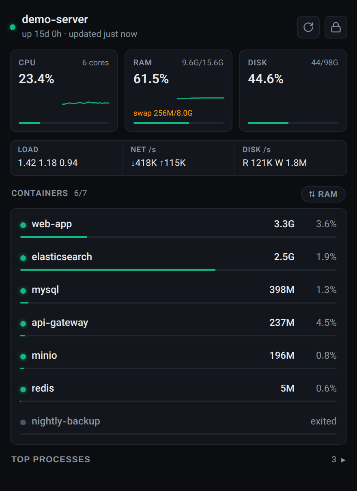

# Server-Pulse Install Guide (English)

🌐 [English](./INSTALL.md) · [فارسی](./INSTALL.fa.md)

Server-Pulse is a tiny tool that shows the live status of your server: CPU, RAM and disk usage, every Docker container, and the most demanding programs, all on one clean dark page.



> The screenshot above uses demo data.

---

## What you need

| Item | Notes |
| :--- | :--- |
| A Linux server | Ubuntu, Debian or similar |
| Docker and Docker Compose | Installed on that server (check with `docker compose version`) |
| SSH access | The way you normally log in to your server |
| Port `9191` open | If the server has a firewall, this port must be allowed |

You do not need to install anything on your own computer or phone. A web browser is enough.

---

## Step 1: Install on the server (once)

1. Connect to your server with SSH.

2. Copy and run this single line:

```bash
curl -fsSL https://raw.githubusercontent.com/Man30ur/server-pulse/main/deploy/install.sh | bash
```

3. Wait a few seconds. The installer does this automatically:

- Puts the program in `/opt/server-pulse` (or your home folder if you are not root).
- Creates a **random token**. Treat it like a password.
- Starts the program with Docker.

4. At the end you will see output like this:

```text
 1) Instant web dashboard (no install, works on phones too):
   http://SERVER_IP:9191/#TOKEN

 2) Chrome extension (live toolbar badge) - paste this link in it:
   pulse://SERVER_IP:9191#TOKEN
```

Keep both links somewhere safe.

---

## Step 2: View your server (the easy way)

Open the first link (starting with `http://`) in any browser, on a computer or a phone. That is all.

- Data refreshes automatically every 3 seconds.
- The browser remembers the token and removes it from the address bar. Next time just open `http://SERVER_IP:9191`.
- Expand **TOP PROCESSES** to see the heaviest programs.
- Use the round arrow button at the top to refresh right now.

### What do the colors mean?

| Color | Meaning |
| :--- | :--- |
| Green | Normal usage (under 65%) |
| Yellow | High usage (65% to 85%) |
| Red | Very high usage (over 85%) |
| Gray | The container is stopped |

---

## Step 3 (optional): Chrome extension for the toolbar badge

If you want the usage percentage to always show on the browser toolbar icon:

1. Go to [Releases](https://github.com/Man30ur/server-pulse/releases/latest), download `server-pulse-extension.zip` and unzip it.
2. In Chrome, open `chrome://extensions`.
3. Turn on **Developer mode** (top right).
4. Click **Load unpacked** and choose the unzipped folder.
5. Click the Server-Pulse icon next to the address bar. If you cannot see it, click the puzzle icon and pin it.
6. Paste the second link (`pulse://...`) into **Server URL**. The address and token are split automatically.
7. Click **Save & Connect**.

Done! A number such as `62%` now shows on the icon. In the extension settings you can choose whether it shows **RAM** or **CPU**.

---

## FAQ

**The page does not open or says "Server offline".**
1. Check that the program is running: `docker ps` (you should see `server-pulse` marked `healthy`).
2. Check that port `9191` is open in the server firewall and in your hosting provider's panel.
3. Check that you typed the IP address correctly.

**I see "Invalid token (401)".**
The token is wrong. Show it on the server:
```bash
grep PULSE_TOKEN /opt/server-pulse/.env
```
Enter the value after `=` in the page (lock icon).

**I lost my links.**
Run this on the server to print the dashboard link again:
```bash
echo "http://$(curl -4s ifconfig.me):9191/#$(awk -F= '/^PULSE_TOKEN=/{print $2}' /opt/server-pulse/.env)"
```

**I want to change the token.**
1. Edit `/opt/server-pulse/.env` and change `PULSE_TOKEN`.
2. Restart the program:
```bash
cd /opt/server-pulse/deploy && docker compose up -d --force-recreate
```
The old token stops working immediately.

**I want to update.**
```bash
cd /opt/server-pulse/deploy && docker compose pull && docker compose up -d
```

**I want to remove it completely.**
```bash
cd /opt/server-pulse/deploy && docker compose down
rm -rf /opt/server-pulse
```

---

## Security: what should I know?

- The program is **read-only**. It cannot stop containers, run commands or change files on your server. Even if the token leaks, only usage statistics can be seen.
- The token is like a password. Do not share the links.
- The default connection uses plain `http` without encryption. If your server has a domain name, put it behind an HTTPS proxy such as Caddy or Nginx, and use `pulses://` instead of `pulse://` in the extension.
- The program uses very little memory (about 3 to 5 MB) and almost no CPU.
